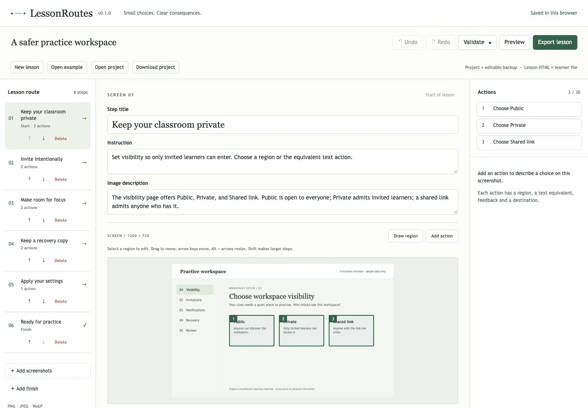

# LessonRoutes

**Turn screenshots into small branching practice lessons.**

[](examples/demo.mp4)

[Watch the real demo (MP4)](https://mikonyaa.github.io/lessonroutes/examples/demo.mp4) · [Try editor](https://mikonyaa.github.io/lessonroutes/) · [Download example project](https://github.com/mikonyaa/lessonroutes/releases/download/v0.1.1/workspace.lessonroutes.project.json) · [Standalone example HTML](https://github.com/mikonyaa/lessonroutes/releases/download/v0.1.1/lesson.html) · [Releases](https://github.com/mikonyaa/lessonroutes/releases/tag/v0.1.1)

An experimental local web editor for teachers making a small practice exercise
from application screens. Add screenshots in a batch, mark rectangular choices,
explain errors, connect destinations, and share one independent HTML with learners.
No account, backend, paid API, external font, analytics, or score collection.

Branching, hotspots, offline authoring and HTML exports already exist in other
tools. LessonRoutes tests a narrower idea: a short path from a screenshot batch to
a small accessible practice lesson. See the [bounded technical comparison](docs/competitive-baseline.md).
There are no teacher pilot results or measured authoring-time advantage yet.

## Try editor

Open the [complete editor on GitHub Pages](https://mikonyaa.github.io/lessonroutes/),
or use the offline web ZIP. Start with **Open example**,
or **New lesson → Add screenshots**. Name each step and give it an instruction and
image description. **Add action** creates a keyboard-editable rectangle; **Draw
region** lets you drag one. Set the action's label, outcome, feedback and destination.
Add a finish and connect the correct path to it. Use **Validate → Preview**.

**Download project** saves an editable `lessonroutes.project.json` backup.
**Export lesson** creates `lesson.html` for learners. These are different files.
The HTML does not reopen in the editor; keep the project JSON to make changes.

The [five-screen example](examples/workspace.lessonroutes.project.json) teaches
private workspace access, class invitations, focused notifications and recovery
copies. Its first screen has two different incorrect choices with explanations
and retries. All screens and text are original fictional materials; no real
account or personal information is shown. [Example license](examples/LICENSE).

## Offline editor

Download and extract [lessonroutes-0.1.1-web.zip](https://github.com/mikonyaa/lessonroutes/releases/download/v0.1.1/lessonroutes-0.1.1-web.zip).
Install **Node.js 24 LTS** first, then run in the extracted folder:

```sh
node serve.mjs --port 0
```

Open the printed loopback URL. No `npm install`, source files, or `node_modules`
are required. The archive contains `app/`, a dependency-free server, licenses,
original examples and [README-OFFLINE.md](README-OFFLINE.md). The server listens on
127.0.0.1, serves only `app/`, rejects traversal and directory listing, and does
not terminate other processes when a port is occupied.

Keep the server terminal open while editing. A new random port creates a new
browser storage origin, so download a project backup before stopping. You may
use a fixed available port to retain the same origin. The exported learner HTML
opens directly via `file://`; **it needs no Node, editor, server, network, account
or persistent storage**. JavaScript must be enabled. Restart explicitly clears
the in-memory learner session.

## Keyboard and narrow screens

Tab to every control; activate with Enter/Space. Use Add action without dragging,
then edit Left/Top/Width/Height as image percentages. Focus a region and use
arrows to move, Alt+arrows to resize, and Shift for larger steps. Undo/Redo buttons
and Ctrl/Cmd+Z (Shift+Z to redo) work outside text fields; inside a text field the
browser's text undo remains available. Dragging is one undo operation. Step
reordering and deleting with link resolution have buttons.

On small viewports, use Screens / Canvas / Actions to switch panels. The player
always shows instructions, image context and an equivalent list of text actions.
Transitions focus the heading; feedback has a polite live region and focuses
Continue. Focus stays visible. There are no decorative animations; reduced-motion
preferences are respected. Image descriptions still need meaningful author review;
automated checks do not prove equivalent learning for a blind learner.

## Image and project limits

| Content | v1 limit |
| --- | --- |
| Images | Up to 50; static PNG, JPEG or WebP bytes only |
| Original bytes | 10 MiB/image, 50 MiB total |
| Dimensions | 24 megapixels; 12,000 pixels/side |
| Lesson nodes | 200 |
| Actions | 30/screen |
| Project JSON | 80 MiB |
| Text | Titles/labels 200 characters; instructions/feedback/descriptions 4,000 |
| Asset names | 240 characters |
| Undo history | 60 operations, with shared immutable asset references |

Animated PNG/WebP, GIF, SVG, remote images and arbitrary data MIME types are
rejected. File names and browser MIME labels are not trusted. A bounded header
reader checks dimensions and animation before browser decoding. Original raster
bytes, their SHA-256 and oriented dimensions are preserved. EXIF-oriented JPEG
uses the same browser orientation and geometry in the editor and player.
Duplicate names are safe; identical bytes are deduplicated. Batch decoding is
sequential and preserves selected file order. Reorder steps with Earlier/Later.

Screenshots can contain private information and original bytes can retain EXIF
and other metadata. **Review/redact your images before sharing. LessonRoutes does
not automatically anonymize images or strip metadata.** Do not import images you
do not have rights to use.

## Graph rules and file safety

Drafts can have no start or incomplete destinations and can still be backed up.
Ready export requires every reachable screen to have instructions, image context,
actions, valid destinations and a path to a finish. Incorrect choices require
feedback. There are no scores; retry cannot add points. Every choice shows feedback
before Continue performs its transition. Repeated activation during feedback is
ignored. A click outside regions gives a calm hint and retains the screen.

Rectangles use normalized image coordinates and may touch but may not overlap.
Positive-area overlaps block export and highlight both regions. Shared right/bottom
edges belong to the region starting at that edge; outer image edges are included.
Contain layout excludes letterboxing from geometry. Retry cycles are permitted
when **every reachable node has some path to finish**. This does not guarantee that
every possible infinite sequence of learner choices terminates.

Export lists the included content and excludes unreachable draft nodes and their
unused images. Editable JSON retains drafts. All user content renders as text;
the exported HTML escapes embedded JSON, bundles the same IIFE runtime used in
preview, and includes a restrictive CSP with a hash for its own script. No dynamic
imports, external styles/scripts/fonts, connections, forms, sibling files or editor
storage are used by the player. See [format and security notes](docs/project-format.md).

## Autosave and recovery

The editor saves projects, assets and the recovery pointer in one IndexedDB
transaction. **Saved** refers to the current session's displayed snapshot, after
transaction completion. Edits during a save remain pending until their own commit.
New/Open/Save a new copy retire the replaced session's saves; a late callback cannot
take back the current pointer or change the new status. A started uncommitted
transaction is aborted. Download a backup before replacing uncommitted edits.
Browser storage is not a backup, can be evicted,
and may be unavailable. Quota, blocked, interrupted and stalled transactions show
an unsaved state; authoring in memory and Download project remain available.
A beforeunload guard is used for unsaved changes, but browsers may not show it.

Revision checks happen within the write transaction. A stale second tab cannot
silently overwrite a newer revision: keep its changes via Download project or
Save a new copy. Reload restores only the last completed browser save. Project
import validates everything before replacing the current lesson; invalid imports
do not merge partial data. Unknown versions and significant fields are rejected.

Startup editing, undo/redo, file inputs and drops wait for the recovery decision.
Storage open/read failures and bounded timeouts report an error and enable work
in memory with Download project. Valid action order is defined by `order`, even
for a shuffled physical array; delete/reorder and Undo/Redo preserve its meaning
in the canvas, inspector, preview and learner export.

Local fix verification and its current limits are recorded separately in
[authoring fixes](docs/authoring-fixes.md). `BUILD.json` in a newly packaged ZIP
identifies its actual local source commit and dirty state; it is not CI evidence.

## Verified browsers

Local macOS checks use Chromium 156.0.8078.4, Firefox 157.0, Playwright WebKit 27.2,
and installed Google Chrome 155.0.8059.39 with isolated profiles. Playwright WebKit
is **not Safari**. The initial autonomous HTML check completed by mouse and keyboard
at 1440 and 390 px, with storage and HTTP/HTTPS disabled, after closing the author
context, from a directory with spaces and Unicode. [Verification report](docs/verification.md).

No universal browser guarantee or manual screen-reader study is claimed. v1 does
not include PWA caching, cloud sync, collaboration, analytics, SCORM/LMS, OCR, AI
authoring, browser recording, input simulation or arbitrary scripts.

## Development and testing

Use Node **24 LTS** (major pinned in .nvmrc, .node-version and package engines).
Exact dependency versions and package-lock.json are committed. Install Playwright
binaries explicitly; they are not included in npm packages or the web ZIP:

```sh
npm ci
npx playwright install --with-deps chromium firefox webkit
npm run dev -- --host 127.0.0.1
npm run typecheck
npm run lint
npm run test:unit
npm run build
npm run test:e2e
npm run package:web
npm run test:production
npm run demo:record
```

On macOS, `npx playwright install chromium firefox webkit` is sufficient if system
prerequisites are present. Browser installation needs a connection. Test servers
allocate loopback ports and tests use isolated temporary browser contexts.
`test:production` extracts the actual final ZIP outside the source tree, starts its
supplied server, authors/imports/exports at root and an arbitrary subpath, and opens
the downloaded HTML offline. `demo:record` requires ffmpeg/ffprobe and records real
browser clips to MP4; it does not fabricate screenshots. The committed demo is
playable without ffmpeg. `examples:generate` regenerates original browser-rendered
artwork; fixture generation also needs ffmpeg for APNG. Generated local evidence
is ignored under `output/playwright/`.

CI on ordinary pull requests is read-only and runs clean install, TypeScript/lint,
import/graph/geometry/runtime/storage unit tests, all three browser projects,
production build, packaging, and consumer verification of the final ZIP. Only
allowlisted synthetic screenshots/reports and the verified build are uploaded.
Actions are pinned to full commit SHAs. Pages is a separate manually dispatched
workflow that deploys `app/` from a successful push/main CI artifact at the chosen
commit; it does not rebuild a different tree or deploy the whole repository.

The [v0.1.0 publication record](docs/publication.md) includes the exact source
commit, successful CI/Pages runs, checksums and public verification. After installing
the documented prerequisites, repeat the unauthenticated public checks with:

```sh
node scripts/public-qa.mjs --repo mikonyaa/lessonroutes --pages https://mikonyaa.github.io/lessonroutes/
```

## License, contributions and security

Code, original screenshots, fixtures, example content and documentation are MIT
licensed. Runtime dependency notices are in [THIRD-PARTY-NOTICES.txt](THIRD-PARTY-NOTICES.txt);
the [development dependency inventory](docs/dependency-licenses.json) records the
lockfile license metadata. No competitor code is included.

See [CONTRIBUTING.md](CONTRIBUTING.md) for scope and meaningful regression checks.
See [SECURITY.md](SECURITY.md) for reporting vulnerabilities without sharing private
screenshots, tokens or project content.
